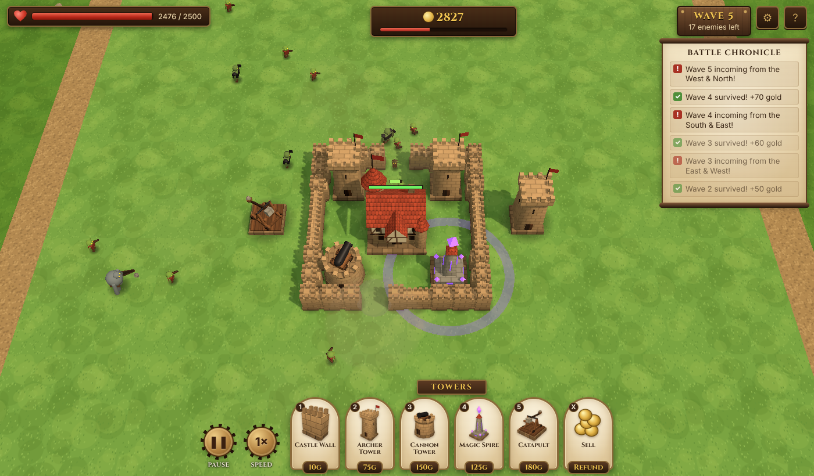

# Hold the Hall

A 3D browser tower-defence / survival game. Raiders pour in from the edges of the map to tear down your
**Town Hall**. Ring it with **castle walls**, raise **archer** and **cannon towers**, and survive as many
waves as you can.



Built with [Three.js](https://threejs.org/) and [Vite](https://vitejs.dev/). Plain JavaScript (ES modules), no assets: every model
is built from primitives in code.

## Quick start

```bash
npm install
npm run dev      # http://localhost:5173
```

| Script            | What it does                                     |
| ----------------- | ------------------------------------------------ |
| `npm run dev`     | Dev server with hot reload                       |
| `npm run build`   | Production build into `dist/` (static, relative paths) |
| `npm run preview` | Serve the production build locally               |
| `npm test`        | Run the headless simulation tests (Vitest)       |

Requires Node 18+.

## Play in the browser (GitHub Pages)

`.github/workflows/deploy.yml` tests and builds every push, and publishes the default branch to GitHub Pages.
One-time setup: **Settings → Pages → Build and deployment → Source: GitHub Actions**. Then push (or run the
workflow from the Actions tab). The game is served at `https://<owner>.github.io/<repo>/`.

GitHub Pages needs a **public** repository on a free GitHub plan; private repos need GitHub Pro, Team or Enterprise.
The build in `dist/` is plain static files (relative paths), so it also works on any static host such as Netlify,
Vercel or Cloudflare Pages.

## How to play

- Enemies spawn in the **dirt border** around the map and march toward the Town Hall.
- You get a build phase before each wave (60s before the first wave, 30s after that). The banner at the top tells you
  what's coming next and from which direction. Press **Space** to start early.
- **Walls don't make enemies give up, they make them choose.** Enemies take the cheapest route to the Town Hall: they walk
  around a short wall, but if the way round is too long (or the Hall is fully enclosed) they smash through. Damaged walls
  are weaker spots and attract attackers. Funnel enemies past your towers, and layer your walls.
- Kills and cleared waves earn gold. Selling a building refunds half its cost, scaled by its remaining HP.
- The Town Hall fires arrows of its own, but it won't hold out alone for long. If it falls, the game is over.

### Controls

| Input                    | Action                                     |
| ------------------------ | ------------------------------------------ |
| `1` / `2` / `3`          | Castle Wall / Archer Tower / Cannon Tower  |
| Left click               | Place building · select building           |
| Left drag (wall mode)    | Paint a line of walls                      |
| `X`                      | Sell mode                                  |
| Right click / `Esc`      | Cancel build mode / deselect               |
| Right drag               | Rotate camera                              |
| Middle drag / `WASD` / arrows | Pan camera                            |
| Mouse wheel              | Zoom                                       |
| `Space`                  | Start next wave now                        |
| `P` / `F`                | Pause / cycle speed (1×, 2×, 3×)           |
| `H`                      | Help                                       |

**On phones and tablets:** tap a build button, then tap or drag on the map to position the building. The map stays
still while you do; drag to the edge of the screen to scroll it. Lift your finger and tap **✓** to build or **✕** to
cancel. You can drag the building again before confirming. Walls are painted directly by dragging. With no build mode
selected, one finger pans; two fingers zoom and rotate. Graphics settings are automatically lighter on touch
devices.

## Documentation

- [Game design](docs/GAME_DESIGN.md): pillars, rules, and current unit and building stats
- [Architecture](docs/ARCHITECTURE.md): how the code is organised and how to extend it
- [Roadmap](docs/ROADMAP.md): troops, heroes, economy, and more

## Project layout

```
index.html            HUD markup
src/
  main.js             entry point
  sim/                pure game simulation (no three.js / DOM), unit-tested
  render/             three.js scene, procedural models, effects
  game/               main loop, input → world commands
  ui/                 DOM HUD
test/                 Vitest tests for the simulation
docs/                 design docs
```
