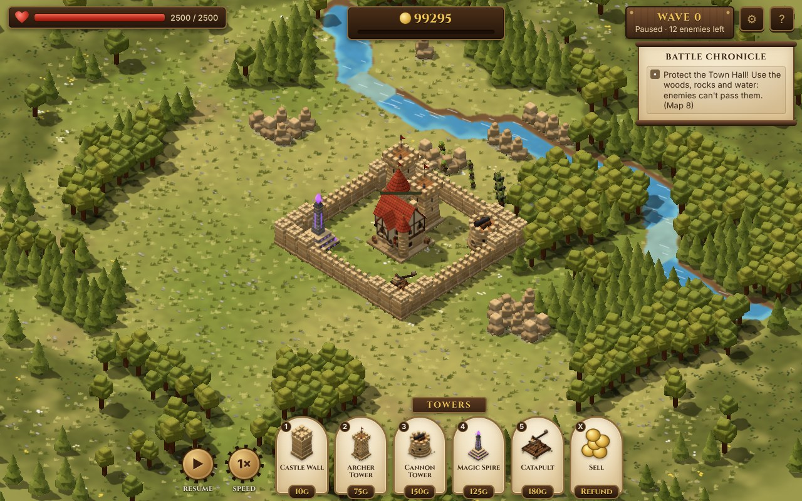
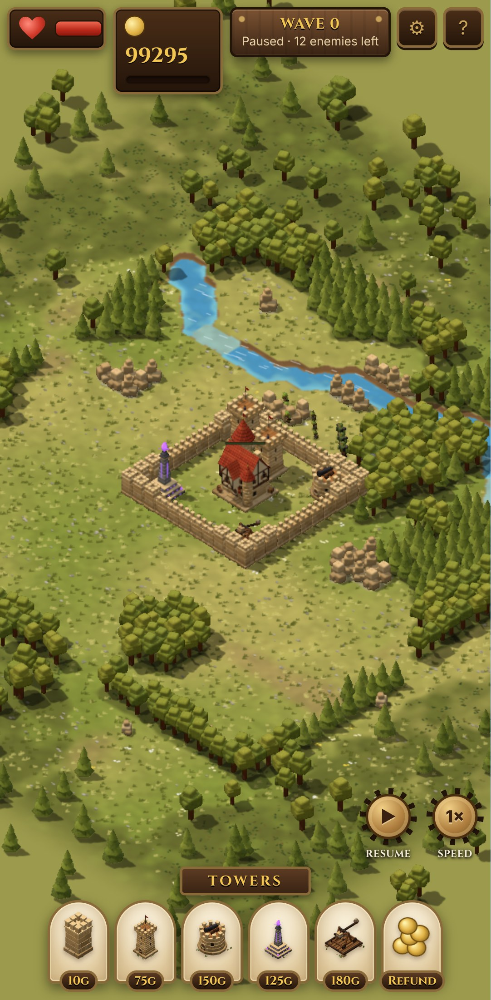

# Hold the Hall

A 3D browser tower-defence / survival game. Raiders pour in from the edges of the map to tear down your
**Town Hall**. Ring it with **castle walls**, raise **archer towers**, **cannon towers**, **magic spires** and
**catapults**, and survive as many waves as you can against goblins, orcs and trolls.

| Desktop | Phone (Pixel 7) |
| ------- | --------------- |
|  |  |

Map 8 (`?seed=8`) on the default High preset.

Built with [Three.js](https://threejs.org/) and [Vite](https://vitejs.dev/). Plain JavaScript (ES modules), no assets: every model
is built from primitives in code.

## Quick start

```bash
npm install
npm run dev      # http://localhost:5173
```

| Script            | What it does                                     |
| ----------------- | ------------------------------------------------ |
| `npm run dev`     | Dev server with hot reload                       |
| `npm run build`   | Production build into `dist/` (static, relative paths) |
| `npm run preview` | Serve the production build locally               |
| `npm test`        | Run the headless simulation tests (Vitest), incl. a check that the pre-baked sprites are current |
| `npm run bake`    | Re-bake the battlefield sprites into `public/sprites/` (run after changing models or textures) |
| `npm run test:e2e` | Vital browser tests (`@smoke`, ~3 min, desktop + phone) |
| `npm run test:e2e:full` | Full browser regression suite (~4 min)      |
| `npm run test:all` | Unit tests + vital browser tests                |
| `npm run test:full` | Unit tests + full browser suite                |

Requires Node 18+.

## Play in the browser (GitHub Pages)

`.github/workflows/deploy.yml` runs the unit tests and builds on every push, then publishes the default branch to
GitHub Pages. The browser tests are a separate, manual workflow: **Actions → "Browser tests (manual)" → Run workflow**, choosing
the `smoke` (vital) or `full` suite.
One-time setup: **Settings → Pages → Build and deployment → Source: GitHub Actions**. Then push (or run the
workflow from the Actions tab). The game is served at `https://<owner>.github.io/<repo>/`.

GitHub Pages needs a **public** repository on a free GitHub plan; private repos need GitHub Pro, Team or Enterprise.
The build in `dist/` is plain static files (relative paths), so it also works on any static host such as Netlify,
Vercel or Cloudflare Pages.

## How to play

- Enemies spawn in the **dirt border** around the map and march toward the Town Hall.
- You get a build phase before each wave (60s before the first wave, 30s after that). The banner at the top tells you
  what's coming next and from which direction. Press **Space** to start early.
- **Walls don't make enemies give up, they make them choose.** Enemies take the cheapest route to the Town Hall: they walk
  around a short wall, but if the way round is too long (or the Hall is fully enclosed) they smash through. Damaged walls
  are weaker spots and attract attackers. Funnel enemies past your towers, and layer your walls.
- Kills and cleared waves earn gold. Selling a building refunds half its cost, scaled by its remaining HP.
- The Town Hall fires arrows of its own, but it won't hold out alone for long. If it falls, the game is over.

### Controls

| Input                    | Action                                     |
| ------------------------ | ------------------------------------------ |
| `1` – `5`                | Castle Wall / Archer Tower / Cannon Tower / Magic Spire / Catapult |
| Left click               | Place building · select building           |
| Left drag (wall mode)    | Plan a wall line (straight or L), shows cost; release to build. Drag onto a tower to join it |
| `X`                      | Sell mode                                  |
| Right click / `Esc`      | Cancel build mode / deselect               |
| Right drag               | Pan camera (the iso view is fixed, like the art reference) |
| Middle drag / `WASD` / arrows | Pan camera                            |
| Mouse wheel              | Zoom                                       |
| `Space`                  | Start next wave now                        |
| `P` / `F`                | Pause / cycle speed (1×, 2×, 3×)           |
| `H`                      | Help                                       |

**On phones and tablets:** tap a build button, then tap or drag on the map to position the building. The map stays
still while you do; drag to the edge of the screen to scroll it. Lift your finger and tap **✓** to build or **✕** to
cancel. You can drag the building again before confirming. Walls work the same way: drag out a line, adjust either
end, then ✓. Dragging a wall end over a tower snaps it onto the tower's side. With no build mode
selected, one finger pans; pinch with two fingers to zoom. Graphics settings are automatically lighter on touch
devices.

## Graphics settings

Open **⚙** in the top bar. The game pauses while the menu is open.

| Preset | Render scale | Anti-aliasing | Frame-rate cap | Scenery and ground detail |
| ------ | ------------ | ------------- | -------------- | ------------------------- |
| Low | Auto | off | 30 fps | low |
| Medium | Auto | off | 60 fps | medium |
| High (always used at startup) | 150% | on | unlimited | high |

**Auto** render scale adjusts itself (50%–150%, capped at the screen's pixel density) to hold the frame-rate
cap: it drops as soon as frames slow down and creeps back up after a few smooth seconds. Shadows are baked into
the sprites, so they cost nothing extra.
The FPS counter also shows the current render scale.

You can override any setting on top of a preset; the preset then shows as **Custom**. There are also toggles for
effects and an FPS counter. Changes apply immediately, except anti-aliasing, which needs a reload. Render scale is
capped at the screen's real pixel density. If the browser resets the graphics, the game automatically drops one
preset (Custom goes to Low) and tells you.

**The game always starts on High**, on every device (it runs well on current phones; if a phone struggles,
pick Medium or Low). Settings you change last until the game is closed or
reloaded, but aren't remembered, so a setting that made the GPU crash can never get stuck on. The one exception
is **Reload now** in the menu (needed to apply anti-aliasing): it keeps your current settings for that single
reload.

## Documentation

- [Game design](docs/GAME_DESIGN.md): pillars, rules, and current unit and building stats
- [Architecture](docs/ARCHITECTURE.md): how the code is organised and how to extend it
- [Roadmap](docs/ROADMAP.md): troops, heroes, economy, and more

## Project layout

```
index.html            HUD markup
src/
  main.js             entry point
  sim/                pure game simulation (no three.js / DOM), unit-tested
  render/             three.js scene, procedural models, effects
  game/               main loop, input → world commands
  ui/                 DOM HUD
test/                 Vitest tests for the simulation
e2e/                  Playwright browser tests (desktop + phone)
docs/                 design docs
```
