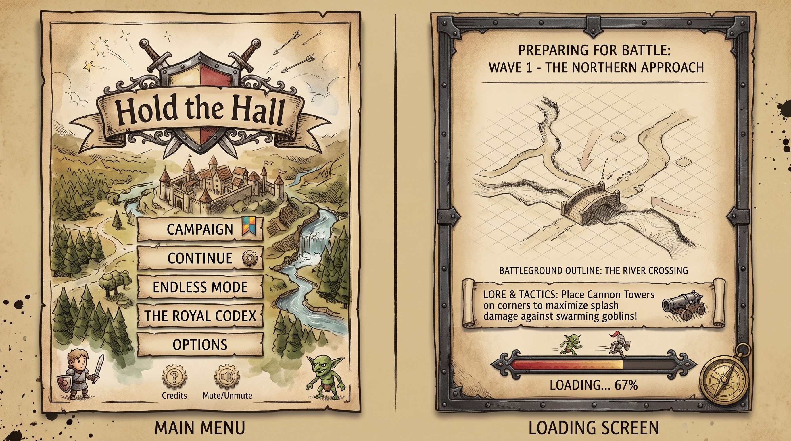

# Game Design

## Pitch

You are the lord of a small town in hostile lands. Each night (wave) raiders come for the **Town Hall**. You
protect it the way medieval towns did: with **walls** that shape where the enemy can go, and **towers** that punish
them for coming. In the long run the town grows an **economy**, trains **troops**, and is led by **heroes** (see the
[roadmap](ROADMAP.md)).

## Design pillars

1. **Walls are a real decision.** Enemies are never fully blocked. They weigh "walk around" against "break through",
   so wall layout is about shaping the cost of each route, not building a maze the AI can't solve.
2. **Readable at a glance.** The next wave's size, type and direction is shown during the build phase. Ranges,
   valid and invalid placement, and damage are always visible.
3. **Survival, not levels.** One map, endless escalating waves, score = waves survived.
4. **Systems that stack.** Every new feature (troops, heroes, economy) should create a new decision that interacts
   with walls and towers, not sit beside them.

## Core loop

```
 Build phase ──► Wave ──► Wave cleared (+gold bonus) ──► Build phase ...
  (countdown,     (enemies spawn from         │
   Space to        1–4 sides, path to Hall,   └─► Town Hall destroyed ──► Game over
   skip)           attack what blocks them)
```

- The map is a 40×40 tile grid. The outer 2 tiles are the **spawn zone**: enemies appear there and you can't build on it.
- The Town Hall (3×3) sits in the centre.
- A partly built fort stands round it at the start (`START_FORT` in config.js): a palisade ring 4–5 tiles out with a
  log gatehouse (twin open-topped towers over a wide gateway) in the south wall and an archer tower in the west wall, open at the north-east corner and beside
  the south-west corner. Enemies come in through the gaps until the player closes them. Starter buildings are free
  and sell for nothing; on maps where terrain is in the way, those pieces are left out.
- You can build and sell during waves too, except on tiles an enemy is standing on or stepping into.

## Enemy pathing: the "breach cost" rule

All enemies share one flow field (Dijkstra from the Town Hall outward). Free tiles cost their step length (1 or √2).
A tile with a building costs an extra `1 + hp × breachCostPerHp`, where `breachCostPerHp = 1/40`. A full-HP wall
(400 HP) therefore counts as roughly an 11-tile detour.

When an enemy's cheapest next step is into a building, it stops and attacks that building. Consequences:

- Short walls get walked around. Long walls, or a full enclosure, get attacked.
- Damaged walls get cheaper, so attackers converge on the breach.
- Enemies re-check their route after every hit: if another breach opens nearby, they switch to it.
- Diagonal movement only works through fully open corners, so diagonal wall lines are solid.
- Terrain (water, rock, forest) can never be entered or broken. Fords cost extra and slow enemies down.

The flow field is recomputed whenever buildings change and every 0.5s during waves, to pick up HP changes.

## Terrain

Maps come in three sizes (Settings → Map size, for new maps): **Small** 40 × 40 tiles, **Medium** 52 × 52 (the
default) and **Large** 64 × 64. Bigger maps give more room to build and longer marches for the enemy.

There are no roads: the map's terrain shapes the routes. Every game generates a new map from its seed (shown in
the Battle Chronicle; `?seed=N` in the URL replays it). Values live in `TERRAIN` in `config.js`.

| Terrain | Enemies | Building | Notes |
| ------- | ------- | -------- | ----- |
| Open ground | walk | yes | |
| Water (stream or lake) | blocked | no | |
| Ford | wade at 60% speed (+1.5 path cost) | no | shallow crossings of a stream |
| Rock | blocked | no | outcrops and ridges; walls join onto them |
| Forest | blocked | no | denser towards the map edge |
| Sea | blocked | no | along one edge on coastal maps; no enemies come from it |
| Beach (sand) | walk | yes | 1–2 tiles between the sea and the land |
| Cliff | blocked | no | the rim of a plateau, standing one level above the ground below |
| Ramp | walk at 75% speed (+0.5 path cost) | no | 2 tiles wide; the only way up or down a level |

About 62% of maps have a stream (crossed at 1–2 fords, each with a way on cleared through any woods or rock on both banks, at least 3 tiles); the rest may have a lake. Settings → Rivers → Always gives
every new map a stream.

About 35% of maps have a **coast**: the sea along one edge (5–7.5 tiles deep, with coves and headlands) behind a
sandy beach. No attacks come from the sea, so there's one side less to defend; a stream that reaches the coast runs
out to sea. Settings → Coast → Never / Sometimes / Always.

About 60% of maps have **hills**: raised plateaus (level 1, sometimes with a level-2 top) ringed by cliffs and
climbed by 1–2 ramps each, kept 2+ tiles from the Town Hall's open area and 3 from the map edge. Walkable ground of
different levels only meets at a ramp. A tower reaches **+1 range per level** it stands on; a building's footprint
must sit on one level ("Uneven ground" otherwise). Arrows shot **up** at higher ground (by towers or enemy archers) reload 50% slower per level up (two-thirds the rate of fire); shooting down is unaffected. Each level is 0.85 units high. Settings → Hills → Never /
Sometimes / Always.

Enemies can't break terrain, so a full enclosure always includes some wall. Every generated map guarantees:

- an open area of 6 tiles around the Town Hall;
- every walkable tile can reach the hall;
- each land side keeps at least 8 reachable edge tiles (enemies only spawn on those; the coast side has none);
- passages are at least 2 tiles wide, so one wall piece can't seal a gap;
- at least 65% of the buildable land is open (the sea doesn't count).

## Buildings

Towers can be built **into a wall line**: the wall tiles under the tower are replaced, and their sell value
(50% of cost × HP fraction) counts towards the tower's price. The rest of the wall joins onto the tower, tied in
with an anchor post. Anything other than walls (another tower, the Town Hall) still blocks placement.
Hovering a wall tile with a tower selected snaps it into the wall: across the middle of a straight run (the wall
carries on from both sides), or onto a corner so both arms join it, preferring the side facing the Town Hall.
A tower in a straight run, on a corner or on a T-junction is drawn with its **in-wall model**: the palisade widens into a log
bastion around it (the watchtower rises out of it; the cannon and catapult stand on a planked rampart; the crystal
mound sits in a low ring), drawn on the wall line or on the corner or T junction (towers are 2 tiles wide and walls 1, so
it's drawn half a tile off its footprint; the footprint for the rules doesn't change). Other arrangements (a wall
alongside, a crossroads) keep the normal tower with anchor posts where the walls meet it.

| Building     | Size | Cost | HP   | Attack                                   | Notes |
| ------------ | ---- | ---- | ---- | ---------------------------------------- | ----- |
| Town Hall    | 3×3  | n/a  | 2500 | 8 dmg, range 5, 1 shot/s                 | Lose when destroyed |
| Castle Wall  | 1×1  | 10   | 400  | none                                     | Drag to plan a line (straight or L); snaps onto towers |
| Archer Tower | 2×2  | 75   | 300  | 14 dmg, range 7, 1.25 shots/s            | Homing arrows |
| Cannon Tower | 2×2  | 150  | 500  | 40 dmg splash r1.6, range 6, 0.45 shots/s | Fires at the ground where the target stood, so it can miss fast enemies |
| Magic Spire  | 2×2  | 125  | 350  | 12 dmg pulse to **all** enemies within 3.5, every 1.4s | Hit enemies are slowed to 60% speed for 1.5s. Best at chokepoints and wall breaches |
| Catapult     | 2×2  | 180  | 300  | 55 dmg splash r1.8, range 10, min range 3, every 3.5s | Long-range siege; can't hit anything closer than 3 tiles, so protect it |
| Gatehouse    | 2×2  | n/a  | 1200 | none                                     | Starting fort only (not buildable or sellable); blocks enemies while it stands, so they smash it or go round |

Towers target the enemy in range that is **closest to the Town Hall** by path distance.
Walls join visually with neighbouring walls and buildings (straight runs, corners and buttressed
junctions), so a line of walls ending at a tower reads as one fortification.
Selling refunds 50% of the cost × remaining HP fraction.

## Enemies

A human army in blue-and-cream livery, marching in **squads**. Men walk to the Town Hall and hack at whatever
blocks their way (walls, towers, the gatehouse); ranged enemies stop and shoot from range instead. Siege engines
hit buildings far harder than men. Damage is against buildings (enemies don't fight anything else yet).

| Enemy          | HP  | Speed (tiles/s) | Damage / hit | Hit every | Range | Gold | Threat | Squad | Appears from |
| -------------- | --- | --------------- | ------------ | --------- | ----- | ---- | ------ | ----- | ------------ |
| Swordsman      | 70  | 1.1             | 6            | 1.0s      | melee | 4    | 1      | 3–5   | wave 1 |
| Pikeman        | 100 | 0.95            | 5            | 1.1s      | melee | 5    | 1      | 3–4   | wave 2 |
| Archer         | 45  | 1.05            | 3            | 1.6s      | 5     | 4    | 1      | 3–4   | wave 3 |
| Battering Ram  | 450 | 0.55            | 90           | 2.2s      | melee | 18   | 6      | 1 + 2 Swordsmen | wave 4 |
| Knight         | 240 | 0.9             | 12           | 1.3s      | melee | 12   | 4      | 1–2   | wave 5 |
| Siege Catapult | 220 | 0.5             | 70           | 5s        | 8     | 20   | 7      | 1 + 2 Pikemen   | wave 6 |

- **Archers** shoot the nearest tower in range; if none, whatever blocks their route once it's in range. Towers
  out-range them (archer tower 7, archers 5).
- **Siege Catapults** batter the wall (or gatehouse, or tower) blocking their route from 8 tiles, else the
  nearest tower. Only the player's Catapult (range 10) out-ranges them.
- Enemy shots hit only the building they're aimed at.

**Elite Knights** (warlords: gold crown, 1.3× size) join every 5th wave as a squad of `n / 5`: ×1.5 HP,
×1.5 damage, ×3 gold.
(Internal ids: `swordsman`, `pikeman`, `archer`, `ram`, `knight`, `mangonel`.)

## Waves

- Each wave has a threat budget: `round(4 + 4n + 0.4n²)`, filled with squads (each squad one type, from one
  side; siege engines bring their escort). See the Threat and Squad columns above.
- Enemy HP scales by `+10%` per wave.
- Attack sides: 1 side for waves 1–2, 2 for waves 3–5, 3 for waves 6–9, and all 4 from wave 10.
- A squad's men step out side by side, 0.25 s apart. Squads follow each other every `max(1.5, 4 − 0.15(n − 1))`
  seconds (±30% jitter).
- Wave clear bonus: `30 + 10n` gold.

## Art direction


The reference sheet above ([`docs/reference/art-style.jpg`](reference/art-style.jpg)) is the target look, including
the five-stage upgrade art for the Town Hall, towers and walls planned on the roadmap. Buildings are currently drawn
at **Stage 1**: the Town Hall is a small stone keep in a fenced yard, the Archer Tower a wooden watchtower, the Cannon
Tower a cannon on a low stone plinth, the Magic Spire a crystal-studded mound, the Catapult a plain wooden one, and
walls a log palisade. Later stages (stone walls and towers, the citadel) arrive with upgrades.


The UI follows [`docs/reference/ui-style.jpg`](reference/ui-style.jpg): bronze-framed plaques for Town Hall health
and gold, a wooden wave sign, arch-topped parchment tower cards with portraits and cost tags, bronze cog buttons,
a "Battle Chronicle" event scroll (desktop; toasts on small screens) and an "Engineer's Codex" panel for the
selected building. (The reference's Upgrade button and spells arrive with those features.)



The menus and HUD dress follow [`docs/reference/ui-menu.jpg`](reference/ui-menu.jpg) and
[`docs/reference/ui-hud-phone.jpg`](reference/ui-hud-phone.jpg): hand-inked parchment with dark iron trim. The
**main menu** is a parchment page with the crest (shield, crossed swords, title ribbon) and plank buttons
(Campaign, coming later; Continue; Endless Mode, or New Battle once one is under way; the Royal Codex of every tower
and foe; Options), the live battlefield showing through it as its picture. The **loading screen** is an
iron-framed page: the coming wave and its approach, an ink sketch of the generated battleground with the first
wave's arrows, its name ("The River Crossing"…), a lore & tactics tip and a progress bar. On phones the HUD's top
plaques sit in a parchment title band; plaques, ribbons and cost tags are parchment, with round bronze buttons.
(There is no sound yet, so the reference's mute button waits for it.)

Warm, storybook medieval: sandstone blocks, red clay roofs, half-timbered plaster, chunky crenellations,
an enemy army of men in blue-and-cream livery (steel helms, round and kite shields, pikes, bows) with hide-roofed
battering rams and wheeled catapults. Terrain follows the reference's environment sheet: blocky olive oaks and
stepped pines, big flat-faced pale sandstone boulders, light straw-olive grass that's nearly flat colour with a fine painted grain, a faint tile grid over the
map, ink lines where kinds of ground meet, sparse dark grass clumps gathered by woods, rocks and water, bright turquoise water sunk below the grass with a brown earth bank on the far side, and strong dark
ground shadows. Sprites get a hand-drawn finish when baked: warm dark-brown ink outlines and inner lines, shading
pulled into soft bands, and light hatching in the shadows. Cloud shadows drift across the battlefield, and streams flow, with foam streaks running downstream round their
bends (lakes glint but stay still), and trees sway in gusts of wind. Battles kick up inked smoke and dust: arrow trails, cannon smoke, impact clouds,
splinters where enemies strike, and debris when a building falls. Damaged buildings and walls show it: soot and cracks below 2/3 health,
then holed roofs, broken stakes, smoke and flames below 1/3. Towers wear the ground bare round them, shots leave scorch marks and
craters that fade, and plank footbridges cross the fords (decoration: wading speed is unchanged). On High, a warm colour
grade and soft glows round crystals, torches and fires. Pennants wave, watchtower lookouts turn to
face their targets, the Town Hall's chimney smokes and crystals sparkle. Each map has a season (summer, autumn leaves, winter
snow) and weather that can change between waves (rain, snowfall); it's looks only and never changes the battle. Birds fly
over and scatter at cannon fire, fish leap in the streams, and deer and rabbits graze at the woods' edge until the
fighting comes near. Woods mix oaks, broad beeches, birch groves, pines
and tall spruces, with the odd dead tree.
Enemies are animated: they walk with a stride matched to their speed, wind up and swing their weapons in time
with their hits, and topple over when killed. Everything is built from code (procedural
textures in `render/textures.js`, models in `render/models.js`), so there are no asset files to manage.

## Economy (v0.1)

Deliberately minimal for now: one currency (gold), 300 to start, income from kills and wave bonuses.
This is the system planned to grow most. See the [roadmap](ROADMAP.md).

## Balance notes

All numbers live in [`src/sim/config.js`](../src/sim/config.js). Rough sanity checks from headless simulation:
an undefended town survives about 1 wave, and a naive bot that only spams towers (no walls) reaches about wave 26.
Balance hasn't been tuned against human play yet.
